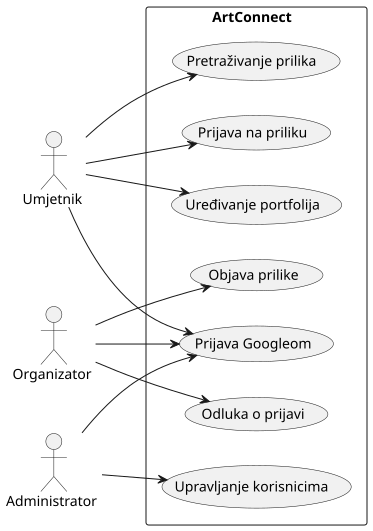

# UML dijagrami (PlantUML)

Dijagrami se pišu kao tekst u `.puml` datotekama u ovoj mapi. GitHub Action
[Generate PlantUML diagrams](../../.github/workflows/generate-puml-diagrams.yaml)
ih pretvara u SVG slike u `docs/assets/diagrams/` (struktura mapa se zrcali).
Slike se ne uređuju ručno.

## Imenovanje

`<poglavlje>-<redni broj>-artconnect-<tema>-<TIP>.puml`, npr. `3-1-artconnect-system-UC.puml`.

| TIP | Dijagram |
| --- | --- |
| `UC` | obrasci uporabe |
| `CMP` | komponente |
| `ERD` | model podataka |
| `CD` | dijagram razreda |
| `SD` | sekvencijski dijagram |
| `SM` | dijagram stanja |
| `DD` | dijagram razmještaja |

## Lokalno renderiranje

```bash
java -jar plantuml.jar -tsvg -failonerror -o "$PWD/izlaz" docs/puml/3-1-artconnect-system-UC.puml
```

Potrebni su Java i Graphviz (`dot`). PlantUML jar se preuzima s
[plantuml.com](https://plantuml.com/download). Za pregled u editoru dovoljan je i dodatak za PlantUML.

## Uključivanje slike u poglavlje

U Markdownu poglavlja:

```markdown

```

Uz sliku navedite izvor, npr. poveznicu na `.puml` datoteku.

## Kako radi workflow

- Pokreće se pri promjeni `docs/puml/**/*.puml` na grani `master` ili ručno (Actions → *Run workflow*).
- Generirane SVG-ove commita natrag u repozitorij kao `github-actions[bot]`, pa prije sljedećeg pusha napravite `git pull`.
- **Zaštita grane:** kad se na `master` uključi obavezan pull request, bot neće moći pushati izravno.
  Plan je tada prebaciti workflow na `pull_request`, tako da bot doda SVG u granu istog PR-a
  (nema dodatne grane ni dodatnog PR-a).

## Izvor workflowa

Workflow `generate-puml-diagrams.yaml` preuzet je iz [predloška kolegija Programsko inženjerstvo](https://github.com/VladoSruk/Programsko-inzenjerstvo).
Autor je Vlado Sruk, licenca MIT (zaglavlje u samoj datoteci ostaje nepromijenjeno).
Naša jedina izmjena: okidač i uvjet na grani `master` umjesto `main`.
